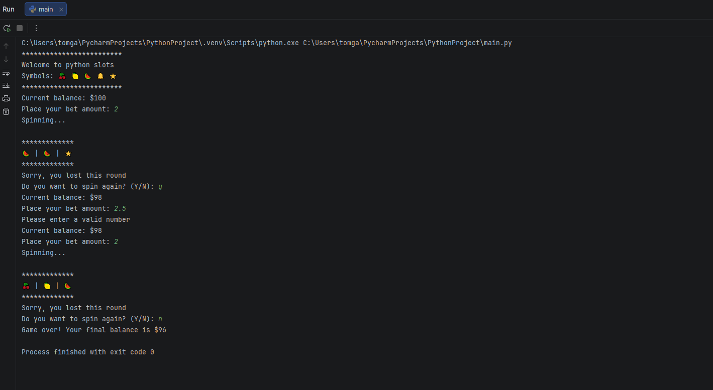

# Python Slot Machine 🎰

A simple slot machine game built with Python. Spin the reels, place your bets, match symbols, and try to increase your balance!

## About the Project

This project is a command-line slot machine game where players start with an initial balance of $100 and place bets on each spin. Winning combinations reward players with payouts based on the matching symbols.

## Features

- Randomly generated slot machine symbols
- Betting system with balance management
- Different payouts for each winning combination
- Input validation
- Option to play multiple rounds
- Automatic game over when the balance reaches zero

## Technologies Used

- Python 3
- Random module

## How to Run

1. Make sure Python 3 is installed.
2. Clone this repository or download the source code.
3. Open a terminal in the project folder.
4. Run the following command:

```bash
python python-slot-machine.py
```

## Author

**Lazaros**

GitHub: [@lazakour](https://github.com/lazakour)
## Screenshot


